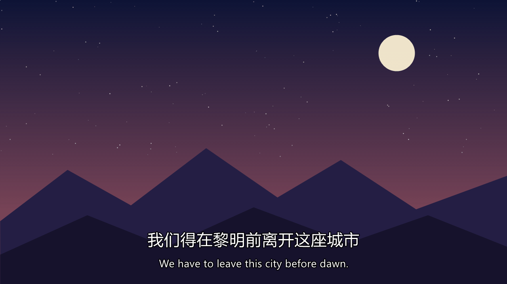

<div align="center">

# 🎬 BannerBlock

**An always-on-top bar that hides the Chinese line of bilingual subtitles.**
Binge your shows. Actually read the English.

[](https://github.com/ctomiao2/BannerBlock/releases)
[](https://github.com/ctomiao2/BannerBlock/releases)
[](LICENSE)
[](https://github.com/ctomiao2/BannerBlock/stargazers)



Drag it over the Chinese line. Double-click to peek. That's it.

**如果这个小程序帮到了你，点个 ⭐ 让更多在学英语的朋友看到！**

</div>

---

## The problem it solves

You promised yourself: *"English subtitles only this time."* You found a great show — with **bilingual subtitles**. Two minutes later you look up and realize you've been reading **Chinese** the whole time.

Your eyes can't help it. The Chinese line is right there, and reading it is effortless — so that's what you read.

**You can't stop reading it. But you can stop *seeing* it.**

BannerBlock is a small always-on-top bar that covers exactly the Chinese line, leaving only the English visible. The translation is still there as a safety net (double-click to peek), but your brain is forced to process English first.

## ✨ Features

- 🔝 **Truly always-on-top** — stays above your player **even in fullscreen** (VLC, PotPlayer, mpv, browsers…). It re-asserts its topmost position 4× per second, so even players that raise themselves lose the z-order fight.
- 🖱️ **Drag anywhere to move, drag edges/corners to resize** — horizontal and vertical.
- 👀 **Peek mode** — double-click to make the bar 30% transparent and check the Chinese, double-click again to restore.
- ⌨️ **Global hotkeys** — nudge position/size pixel-perfect with the keyboard while the player is fullscreen.
- 🎯 **Zero interference** — clicking the bar never steals keyboard focus from the player: Space still pauses, arrows still seek. The bar doesn't show up in the taskbar or Alt-Tab.
- 📌 **Remembers everything** — position, size, color and opacity are restored on the next launch.
- 📦 **One 18 KB exe, nothing to install** — runs on the .NET Framework already built into Windows. No background services, no config to edit.

## 🚀 Quick start

1. Download **[`BannerBlock.exe`](https://github.com/ctomiao2/BannerBlock/releases/latest)** (18 KB)
2. Double-click it. A black bar appears near the bottom of your screen.
3. Drag it over the Chinese subtitle line. Resize if needed.
4. Enjoy the show. 🍿

## ⌨️ Hotkeys (work even while the player is fullscreen)

| Key | Action |
| --- | --- |
| `Ctrl`+`Alt`+`B` | Show / hide the bar |
| `Ctrl`+`Alt`+`←` `→` `↑` `↓` | Nudge position (8 px per press) |
| `Ctrl`+`Alt`+`Shift`+`←` `→` `↑` `↓` | Nudge size |
| `Ctrl`+`Alt`+`Q` | Quit |

Right-click the bar for the menu: colors, opacity, re-center, help.

## 🧠 How does it stay on top of a fullscreen player?

Three Win32 tricks working together:

1. **`WS_EX_TOPMOST`** puts the bar in the topmost window band.
2. A **250 ms timer** calls `SetWindowPos(HWND_TOPMOST)` over and over — if a fullscreen player raises itself into the topmost band, the bar immediately climbs back above it.
3. **`WS_EX_NOACTIVATE`** means clicking the bar never activates it, so the player keeps keyboard focus.

The borderless bar is draggable because it reports itself as a **title bar** (`HTCAPTION`) everywhere except an 8 px frame around the edges, which reports as native resize handles.

> ⚠️ One exception: a player in *exclusive fullscreen* (D3D) can't be covered by any normal window. Turn off "exclusive fullscreen" in the player's settings — almost all players default to borderless fullscreen anyway.

## 🔨 Build

One file, one command, no Visual Studio needed — the compiler ships with Windows:

```
C:\Windows\Microsoft.NET\Framework64\v4.0.30319\csc.exe /nologo /target:winexe /codepage:65001 ^
  /r:System.dll /r:System.Drawing.dll /r:System.Windows.Forms.dll ^
  /out:BannerBlock.exe BannerBlock.cs
```

The app UI is currently in Chinese (it was born for a Chinese learner 🙂). PRs adding localization are very welcome.

---

## 中文说明

**字幕遮挡器** —— 看剧学英语的小工具。

双语字幕总是忍不住先看中文？用一个**永远置顶**的黑色小横幅把中文那一行精准盖住，只留英文；没看懂时双击横幅变半透明偷看一眼，再双击恢复不透明。全屏播放也照样盖得住（无边框全屏的播放器都行），点横幅不会抢播放器的焦点，空格照样能暂停。

**用法**

- 双击 exe 运行 → 拖动横幅盖住中文字幕行；拖动边缘/四角可横向、纵向缩放
- 双击横幅 = 偷看 / 恢复；右键横幅 = 菜单（颜色 / 不透明度 / 回到屏幕底部居中 / 退出）
- 位置、大小、颜色自动记住，下次打开自动恢复
- 程序不占任务栏，右下角托盘有图标

**快捷键**：`Ctrl+Alt+B` 显示/隐藏 ｜ `Ctrl+Alt+方向键` 微调位置 ｜ `Ctrl+Alt+Shift+方向键` 微调大小 ｜ `Ctrl+Alt+Q` 退出

**注意**：极少数播放器开了"独占全屏"时任何窗口都无法覆盖，把播放器设置里的独占全屏关掉即可；若 `Ctrl+Alt+方向键` 被显卡驱动的屏幕旋转快捷键占用，鼠标操作不受影响。

## 📄 License

[MIT](LICENSE) — free for personal and commercial use.
